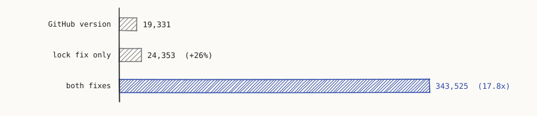
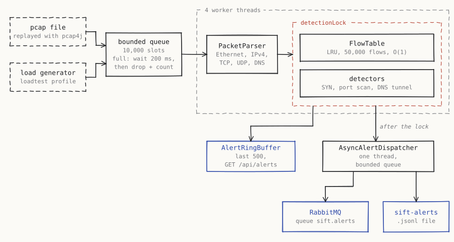
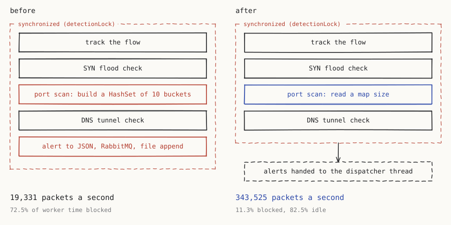
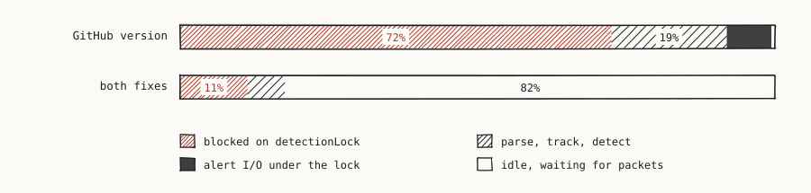
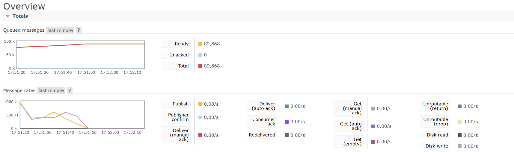

# Sift

A network anomaly detector written in Java. It reads raw network packets, decodes the Ethernet, IP, TCP, UDP and DNS headers byte by byte, tracks each conversation (flow) in an LRU cache I wrote myself, and flags three kinds of attack: SYN floods, port scans and DNS tunneling.

There is no machine learning and no trained model. Every detection rule is a plain statistical threshold you can check with a pencil.

Full writeup with a demo that runs the real detection rule on any domain you type: [tanishqchoudhary.vercel.app/sift](https://tanishqchoudhary.vercel.app/sift).

## The short version

| | |
|---|---|
| Throughput, no rate limit | 343,525 packets a second over 3,000,000 packets |
| Same test before the two lock fixes | 19,331 packets a second |
| Packets dropped | 0, in every run |
| CPU at a 50,000 packets/s target | 7.6% of the whole CPU |
| Worker time blocked on the lock, at a 50,000 target | 72.5% before, 11.3% after |



Measured on my laptop (Intel i7-13620H, 10 cores, 16 threads) with the `loadtest` profile. CPU percentages are of all 16 threads. The raw output of every run is in [docs/benchmarks](docs/benchmarks).

## Why it is built this way

Most packet inspection demos call a library to do the parsing, which means the interesting part never gets touched. This project writes the byte-level parsing, the LRU cache and the streaming statistics by hand, because those are the parts worth understanding. `pcap4j` is used only to get raw bytes out of a capture file.

RabbitMQ is here for exactly one reason: sending alerts to whatever wants them downstream. Alerts are notifications, not an ordered log anyone needs to replay or partition, which is Kafka's job, so there is no Kafka. There is no database for packet or flow state either. Alerts are also appended to a JSON-lines file.

## How it works



Packets go into a bounded queue of 10,000. If it is full, the producer waits 200 ms, then drops the packet and counts it. Four workers parse each one, update its flow and run the detectors under one lock, then hand any alerts to the API buffer and a background dispatcher. Flows are keyed by source and destination IP and port plus protocol.

Parsing follows the RFC layouts directly. The IPv4 header length comes from the IHL field and the TCP header length from the data offset, so options are handled. Every length is checked against the bytes actually captured, and a malformed packet is skipped and counted instead of crashing anything.

The flow table is a HashMap plus a doubly linked list: lookup, move-to-front and evict are all O(1). It holds 50,000 flows and evicts the least recently used, so someone inventing fake flows cannot make it grow forever.

Running averages use Welford's algorithm, which updates the mean and variance one value at a time without storing history and without the rounding errors of the textbook formula.

## The detection rules

- SYN flood: a source sending SYN packets much faster than its own normal rate. The rate is SYNs per second over the last 10 seconds, compared with that source's running mean and standard deviation, and flagged when the z-score goes above 3 (configurable). A source needs 30 seconds of history before it can be judged, and it alerts once per episode.
- Port scan: one source contacting more than 20 different destination ports within 10 seconds.
- DNS tunneling: a query name that looks random (Shannon entropy above 3.5 bits per character) and has a label at least 20 characters long. It needs both. Plenty of ordinary long internal names score above 3.5; they just do not have a 20-character label.

## The bug that looked like a hardware ceiling

Throughput settled at about 19,000 packets a second and stayed there, whether the load generator was set to 50,000 a second or unthrottled. If the ceiling does not move when the input rate changes, the input rate was never the bottleneck.

My first guess was the CPU, choking on byte parsing. It was at 9%. Forty thread dumps taken mid-run said the four workers spent 72% of their time `BLOCKED` on one lock, `detectionLock` in `PacketPipeline`. It wrapped detection, which is fine, but inside it each thread was also serializing alerts to JSON, publishing them to RabbitMQ and appending them to a file. Network and disk I/O, one thread at a time.

Fix one moved alerting onto a background thread (`AsyncAlertDispatcher`) with its own bounded queue, so the lock only covers in-memory work. That was worth 26%, and I nearly stopped there. But the thread dumps still said 72% blocked. The I/O only ran for the 3% of packets that raise an alert.

So I looked at what the thread holding the lock was doing. 36 of 41 samples were in `SlidingWindowUniqueCounter.uniqueCount`, the port scan rule's "distinct ports in the last 10 seconds". It built a fresh `HashSet` from ten one-second buckets on every TCP and UDP packet. For a source in the middle of a scan, that copies every port it has touched, per packet, while three threads wait.

Fix two keeps a count per port of how many live buckets hold it, so the distinct count is the size of a map. A test feeds it 20,000 random packets and checks every answer against the old union-of-sets version.

Unthrottled, 3,000,000 packets: 19,331 a second with the original code, 24,353 with fix one, 343,525 with both. None dropped. At a 50,000 target the workers now spend 82% of their time idle.







## Running it

The app runs directly on your machine rather than in Docker. pcap4j needs libpcap on Linux and macOS, or Npcap on Windows, even for reading files.

The sample captures are generated, not committed. Create them first:

```bash
cd scripts
pip install -r requirements.txt
python generate_attack_pcap.py
cd ..
```

That writes `normal_http_traffic.pcap`, `dns_traffic.pcap` and `mixed_traffic.pcap` into `src/main/resources/pcaps/`. The default config replays `mixed_traffic.pcap`, which holds one normal HTTP conversation and one DNS query. It is there to show parsing and flow tracking on real packet bytes, not to trigger alerts.

Start RabbitMQ, Prometheus and Grafana. Sift connects to RabbitMQ on startup, so it has to be up first:

```bash
docker compose up -d
```

Then run it:

```bash
mvn spring-boot:run
```

To see the detectors fire, use the load generator instead of the capture:

```bash
mvn spring-boot:run -Dspring-boot.run.profiles=loadtest
```

The `loadtest` profile sends a mix of normal traffic, SYN flood, port scan and DNS tunneling (70/20/7/3 by default) from four threads at a target rate. Profiles, totals and the mix are set under `sift.loadgen` in `application-loadtest.yml`.

Grafana is at http://localhost:3000, Prometheus at http://localhost:9090, the RabbitMQ console at http://localhost:15672. `scripts/seed_demo.ps1` starts the app and prints the commands for checking alerts.

## API

```
GET /api/alerts?limit=50
```
```json
{ "alerts": [ { "type": "PORT_SCAN", "sourceIp": "10.0.0.51", "detail": "21 distinct destination ports contacted within 10s", "score": 21.0, "timestamp": "2026-01-01T00:00:01.200Z" } ] }
```

```
GET /api/flows/top?by=packetRate&limit=20      (or by=byteRate)
```
```json
{ "flows": [ { "flowKey": "10.0.0.11:51500 -> 10.0.0.21:80 (TCP)", "packetRate": 0.6, "byteRate": 12.3 } ] }
```

`GET /api/health` returns packets processed and dropped, active flows, alerts raised and queue depth. Metrics for Prometheus are at `/actuator/prometheus`.

## Tests

```bash
mvn clean test
```

Parser tests build real packets byte by byte (a TCP SYN, a DNS query, a truncated frame, an IPv6 frame that should be skipped). There are tests for the LRU eviction order, Welford against hand-computed values, entropy, the sliding windows, each detector on normal and attack traffic, each traffic generator actually tripping its detector, and backpressure: a queue of one that nobody drains, five packets in, one accepted, four dropped.

Two tests cover the lock fixes. One gives the alert dispatcher a RabbitMQ publisher that takes 300 ms per alert and checks that raising three alerts still returns in under 100 ms, with all three delivered once the dispatcher closes. The other runs the new port counter against the old union-of-sets version on 20,000 random packets and compares every answer.

Two tests need setup first. The pipeline test replays `mixed_traffic.pcap`, so generate the captures, and the RabbitMQ test needs a broker on `localhost:5672`, so run `docker compose up -d`.

## What I would change next

- Give each worker its own slice of source IPs, so there is no shared state, no lock even for the counters, and packets from one source stay in order. 11% of worker time still goes to waiting on that lock.
- The per-source maps inside the detectors are not bounded the way the flow table is. Spoofed source addresses could grow them without limit.
- The DNS rule alerts on every matching packet. It needs the same "alert once per episode" memory the other two have.
- Entropy is measured over the whole name, so a long but readable hostname can be flagged. Measuring the long label on its own would cut those false positives.
